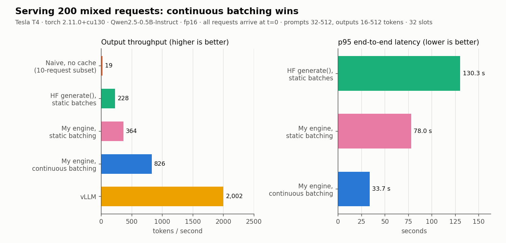
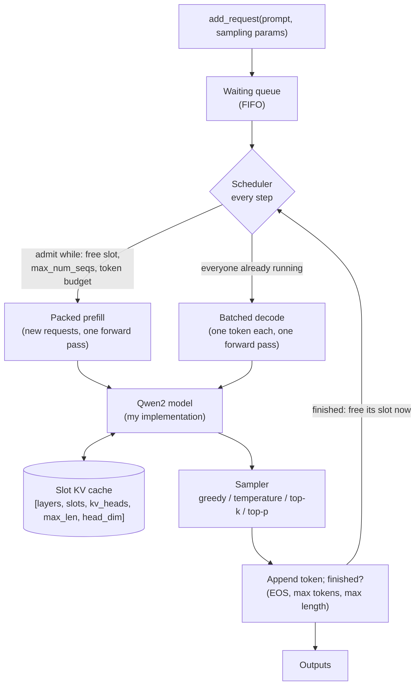
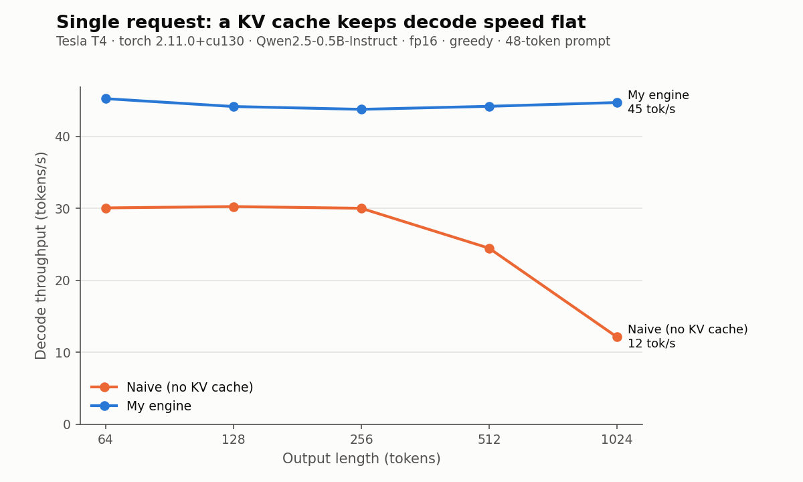
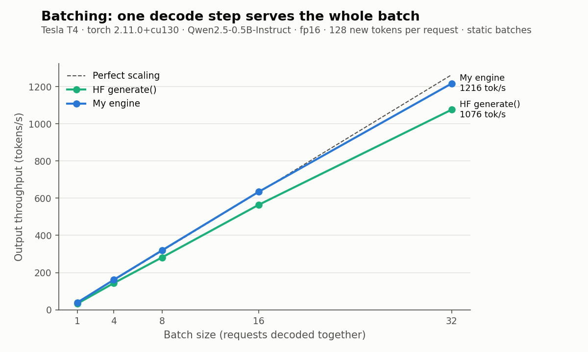
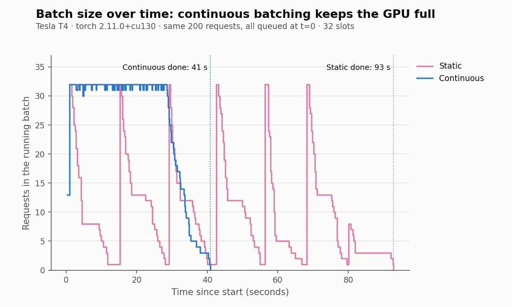
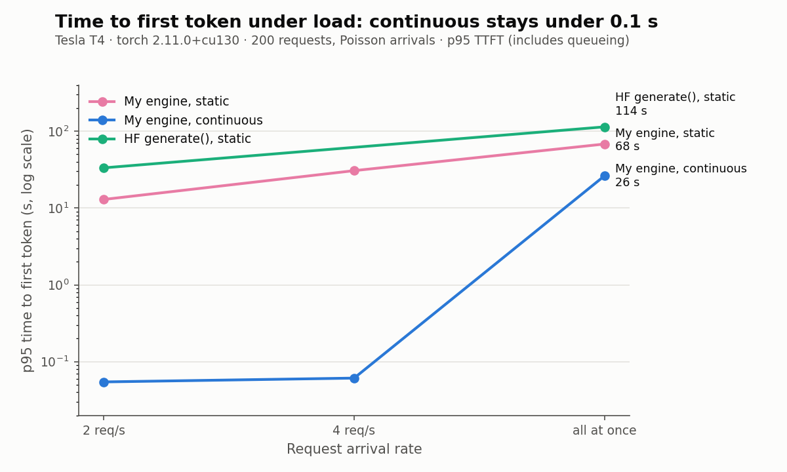
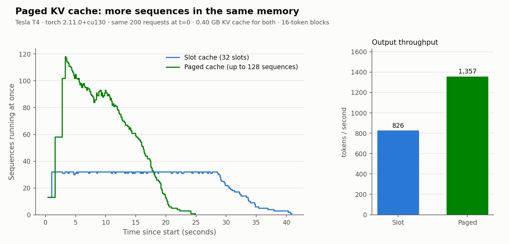
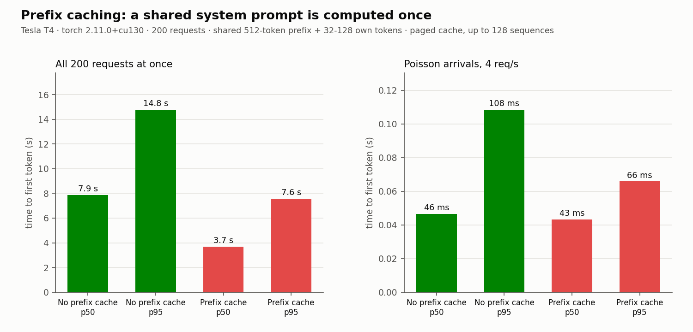
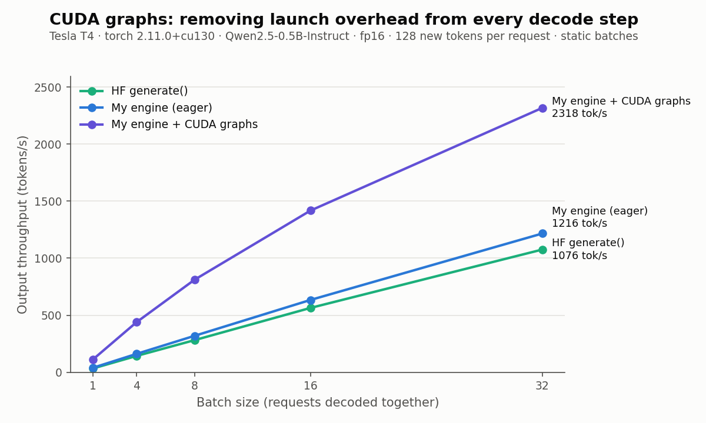

# Mini LLM Inference Engine

A small LLM inference engine written from scratch in Python and PyTorch, in
the style of [nano-vLLM](https://github.com/GeeeekExplorer/nano-vllm). It has
its own Qwen2 model implementation (loading Hugging Face weights), its own KV
cache, a request queue and scheduler, continuous batching and per-request
sampling, and it serves many requests at once on a single Colab **Tesla T4**.
Every output is checked against Hugging Face, and every number below was
measured on that T4.

**Headline:** on a workload of 200 requests with mixed prompt and output
lengths, **continuous batching gives 2.3x the throughput of static batching
in the same engine (826 vs 364 tokens/s) and 3.6x Hugging Face `generate()`
with static batching (228 tokens/s)**. Under a steady 4 requests per second,
the 95th-percentile time to first token is **0.06 s with continuous batching
versus 30.7 s with static batching**. Real vLLM (2,002 tokens/s) is 2.4x
faster than that first engine.

Stage 6 closes much of the gap. A **paged KV cache** fits 119 sequences in the
memory that held 32, and **CUDA graphs** remove most of the per-step launch
overhead. Together they reach **1,507 tokens/s on the same workload, 1.8x the
slot-cache engine, with vLLM now 1.3x ahead** ([why](#honest-limitations)).
**Prefix caching** halves the time to first token when requests share a
system prompt, and a FastAPI server streams tokens with Server-Sent Events.



## Contents

1. [How LLM inference works](#how-llm-inference-works)
2. [Architecture](#architecture)
3. [Design decisions and trade-offs](#design-decisions-and-trade-offs)
4. [Results](#results)
   (plus [Stage 6: streaming server, paged KV cache, prefix caching, CUDA graphs](#stage-6-streaming-server-paged-kv-cache-prefix-caching-cuda-graphs))
5. [Things that surprised me](#things-that-surprised-me)
6. [Honest limitations](#honest-limitations)
7. [How to run it](#how-to-run-it)
8. [Repository layout](#repository-layout)
9. [References](#references)

## How LLM inference works

**Tokens.** A language model reads and writes *tokens*: pieces of words
(Qwen2.5 has 151,936 of them). Generating text is a loop: feed in the tokens
so far, get a probability for every possible next token, pick one, append it,
repeat.

**Prefill and decode.** A request has two phases:

* **Prefill** processes the whole prompt in one forward pass. Hundreds of
  tokens go through the model together, so the GPU has plenty of maths to do
  for every weight it reads. Prefill is limited by compute.
* **Decode** then produces the answer one token per forward pass. Each step
  processes a single new token per request.

**Why decode is memory bound.** To produce one token, the GPU must read every
weight of the model from its memory: about 1 GB for Qwen2.5-0.5B in fp16. The
T4 reads memory at roughly 320 GB/s, so that alone takes about 3 ms. The
maths for one token is tiny in comparison (two operations per weight). The
GPU spends its time waiting for memory, not computing.

**The KV cache.** Attention lets each token look at all earlier tokens through
their *key* and *value* vectors. Those never change once computed, so we store
them: that store is the KV cache. Without it, every decode step recomputes
keys and values for the whole sequence, and gets slower as the text grows
(the orange line in chart 1). With it, a decode step only computes them for
the one new token. For this model a token's cache entry is 12 KB (24 layers x
keys and values x 2 KV heads x 64 dims x 2 bytes).

**Why batching helps.** Because decode is memory bound, reading the weights
once and using them for 32 requests costs almost the same as using them for
one. In my measurements, a decode step for 32 sequences takes only about 4%
longer than for one, so throughput grows almost 32x (chart 2).

**Why continuous batching helps.** With *static* batching, a batch of
requests starts together and runs until its longest request finishes. Short
requests finish early and their places sit empty, and new requests wait
outside until the whole batch is done. It is like a restaurant that seats a
group of 32 and will not seat anyone new until the last diner of that group
has left. *Continuous* batching (from the Orca paper) gives a table to the
next person in the queue the moment any diner leaves: the scheduler checks
after every decode step, removes finished requests and admits waiting ones,
so the batch stays full (chart 4).

**What paged attention solves.** My cache gives every running request a
fixed-size slot of `max_model_len` tokens, whether it uses 50 or 1,000 of
them. Most of that memory is wasted, which limits how many requests fit at
once. vLLM's PagedAttention splits the cache into small blocks (like pages of
virtual memory) and hands them out as a sequence grows, so almost no memory
is wasted and many more sequences fit in the same GPU.

## Architecture



One call to `LLMEngine.step()` does exactly what the diagram shows:

```python
batch = scheduler.schedule()            # who prefills, who decodes this step
for group in packs(batch.prefills):     # new requests, packed within the token budget
    logits = runner.prefill_packed(group)
    append(sample(logits))              # first token of each new request
if batch.decodes:
    logits = runner.decode(batch.decodes)   # ONE forward pass for every running request
    append(sample(logits))              # finished requests free their slot here
```

## Design decisions and trade-offs

**My own model, with fused projections.** [`engine/model.py`](engine/model.py)
implements Qwen2 from scratch: embedding, RMSNorm (statistics in fp32), RoPE
with precomputed cos/sin tables, grouped-query attention through PyTorch's
SDPA, SwiGLU MLP and tied input/output embeddings. Every size comes from the
model's `config.json`. Unlike Hugging Face, q/k/v are one matrix and the MLP's
gate/up are one matrix: fewer, bigger matmuls, which matters when each decode
step is dominated by kernel launch overhead. The loader
([`engine/loader.py`](engine/loader.py)) has an explicit name map from the
checkpoint to my modules, slices the fused matrices together, and refuses to
run if any weight is missing or left over.

**The model does not own the cache.** Each attention layer hands its new
q, k, v to an `AttentionContext`, which stores k/v and runs attention. The
same model therefore runs with no cache (parity tests), a single-sequence
cache (Stage 2), the batched slot cache, and packed prefill, without changes.

**A slot cache first.** One big tensor is allocated at start-up and each
running request owns one slot. It is simple and makes correctness easy to
test. The cost is wasted memory (every slot reserves `max_model_len`
positions), which is exactly the problem paged attention solves.

**Different lengths in one batch: positions and masks.** In a batched decode
step every sequence sits at a different position. Each new token gets its own
RoPE position (its sequence's current length) and is written into its slot at
that position. For attention, every sequence's keys are gathered up to the
longest length in the batch, and a mask built from the per-slot lengths hides
the rest. That rest may be empty or may be stale data from the slot's previous
owner; freed slots are never cleared, because the mask makes clearing
unnecessary. A unit test deliberately leaves junk in a reused slot to prove it.

**Prefill: one at a time first, then packed.** I started with one prefill
forward pass per request, as the brief suggested. Measurements showed it was
the main reason my engine fell behind Hugging Face at batch 32: each forward
pass costs about 25 ms of fixed overhead, paid 32 times. Prompts are now
packed end to end into one forward pass, with a block-diagonal causal mask so
each token only sees its own prompt, capped by the step's token budget. Batch
32 went from 1,011 to 1,216 tokens/s. One-at-a-time prefill is kept as an
option (`EngineConfig.batched_prefill=False`).

**Decode attention without copying KV for GQA.** Qwen2.5-0.5B has 14 query
heads but only 2 KV heads. Instead of repeating each KV head 7 times, the 7
query heads that share a KV head are regrouped as 7 "query positions" against
that one head: the same maths in one SDPA call. It was correct, but it only
gained about 2%, which is how I found out the real bottleneck was prefill.

**Scheduler.** Strict first-come-first-served admission while three limits
allow it: a free slot, `max_num_seqs`, and `max_num_batched_tokens` (a decode
costs 1 token, a prefill costs its prompt length, so a burst of long prompts
cannot stall running decodes for long). Finished requests free their slot
immediately. The static-batching baseline is the same engine with one rule
changed (`scheduling="static"`: admit only when nothing is running), so the
comparison isolates the batching policy.

**Sampling.** Greedy, temperature, top-k and top-p are applied to the whole
batch in one set of tensor operations, each row with its own settings, using a
seeded generator so runs are reproducible.

**Correctness is tested before speed.** Every stage has tests that ran on the
T4 (45 tests, all passing). The important ones:

| Test | What it checks |
|---|---|
| `test_model_parity.py` | fp32 logits vs Hugging Face: bit-identical on CPU, within 1e-3 on the T4, including 20 cached decode steps. fp16 greedy output vs HF `generate()`: 50 tokens on 5 prompts (details under surprises). |
| `test_kv_cache.py` | Batched decode and packed prefill give each sequence exactly the attention it would get alone; static batches match single-sequence output exactly (fp32 and fp16). |
| `test_engine_parity.py` | 8 requests arriving at different times, queueing, joining and leaving the batch: every output identical to running that request alone (fp32 and fp16). |
| `test_scheduler.py` | Slots reused and never shared, `max_num_seqs` respected, FIFO order, token budget, static mode, over-long prompts rejected with a clear error. |
| `test_sampler.py` | Greedy = argmax, top-k = 1 is greedy, seeds reproduce, top-k/top-p only sample allowed tokens. |
| `test_api.py` | Streaming returns one event per token; streaming and non-streaming text agree; 4 concurrent requests share 2 slots; errors come back as HTTP 400. |
| `test_cuda_graphs.py` | Graph-replayed decoding gives exactly the eager outputs (fp32), and fp16 matches running each request alone, for both caches. |

## Results

**Setup for every number:** Tesla T4 16 GB (Colab), torch 2.11.0+cu130, CUDA
13.0, transformers 5.20.2, model `Qwen/Qwen2.5-0.5B-Instruct` in float16,
SDPA attention. Warm-up runs are excluded and timings are wrapped in
`torch.cuda.synchronize()`. Raw results, with environment details, are the
JSON files in [`benchmarks/results/`](benchmarks/results/).

### 1. A KV cache makes decode speed independent of length



One request, 48-token prompt, exactly N new tokens:

| Output tokens | Naive (no cache) | HF `generate()` | My engine |
|---:|---:|---:|---:|
| 64 | 30.1 tok/s | 33.0 tok/s | 45.2 tok/s |
| 256 | 30.0 tok/s | 33.3 tok/s | 43.8 tok/s |
| 512 | 24.5 tok/s | 34.0 tok/s | 44.2 tok/s |
| 1024 | 12.1 tok/s | 33.7 tok/s | 44.7 tok/s |

### 2. Batching: one decode step serves the whole batch



B requests start together, 128 new tokens each:

| Batch size | My engine | My engine, one-at-a-time prefill | HF `generate()` |
|---:|---:|---:|---:|
| 1 | 39 tok/s | 40 tok/s | 34 tok/s |
| 4 | 161 tok/s | 158 tok/s | 143 tok/s |
| 8 | 319 tok/s | 300 tok/s | 281 tok/s |
| 16 | 634 tok/s | 577 tok/s | 564 tok/s |
| 32 | **1,216 tok/s** | 1,011 tok/s | 1,076 tok/s |

### 3. Serving a mixed workload: static vs continuous vs vLLM

The workload ([`benchmarks/workload.py`](benchmarks/workload.py), fixed seed):
200 requests, prompts of 32 to 512 tokens, outputs mostly short (70% between
16 and 128 tokens) with some long ones (30% between 256 and 512). EOS is
ignored so every backend generates exactly the same tokens. All backends use
at most 32 concurrent sequences and a 1,024-token context.

**Offline** (all 200 requests arrive at once; measures peak throughput):

| Backend | Output tok/s | Requests/s | Total time | TTFT p50 / p95 | TPOT p50 / p95 | End-to-end p50 / p95 | Peak memory |
|---|---:|---:|---:|---:|---:|---:|---:|
| Naive, no cache (10-request subset) | 19 | 0.16 | 62.1 s | 18.1 / 55.5 s | 42 / 66 ms | 37.0 / 59.8 s | 1.42 GB |
| HF `generate()`, static batches of 32 | 228 | 1.35 | 148.3 s | 71.0 / 113.9 s | 37 / 45 ms | 72.5 / 130.3 s | 1.82 GB |
| My engine, static batching | 364 | 2.16 | 92.8 s | 42.0 / 68.1 s | 27 / 45 ms | 43.5 / 78.0 s | 1.63 GB |
| **My engine, continuous batching** | **826** | **4.89** | **40.9 s** | 13.3 / 26.3 s | 31 / 37 ms | **18.4 / 33.7 s** | 1.62 GB |
| vLLM 0.32.0 | 2,002 | 11.86 | 16.9 s | n/a | n/a | n/a | n/a |

TTFT = time to first token, including time spent queueing. TPOT = time per
output token after the first. Peak memory is `torch.cuda.max_memory_allocated`
and includes my preallocated 32-slot cache (384 MB). vLLM's offline API in
this version did not return per-request timestamps, so only its throughput is
reported; vLLM also manages its own memory pool, so its peak memory is not
comparable and is left out.

**Batch size over time** for the same offline run. Continuous batching keeps
all 32 slots busy until the queue is empty; static batching drops to a handful
of requests while each batch waits for its longest member:



**Online** (Poisson arrivals at a fixed rate; measures latency under load):



| Backend | Rate | TTFT p50 / p95 | TPOT p50 / p95 | End-to-end p50 / p95 |
|---|---:|---:|---:|---:|
| **My engine, continuous** | 2 req/s | **0.037 / 0.055 s** | 27 / 29 ms | 2.3 / 11.8 s |
| My engine, static | 2 req/s | 6.9 / 12.9 s | 27 / 33 ms | 10.7 / 21.8 s |
| HF `generate()`, static | 2 req/s | 13.4 / 33.3 s | 36 / 43 ms | 20.5 / 43.6 s |
| **My engine, continuous** | 4 req/s | **0.040 / 0.061 s** | 29 / 32 ms | 2.5 / 13.0 s |
| My engine, static | 4 req/s | 14.6 / 30.7 s | 27 / 41 ms | 18.8 / 36.5 s |

With continuous batching a new request starts within one decode step of
arriving, so TTFT stays at about 40 ms. With static batching it must wait for
the current batch to finish completely.

### 4. Requests joining and leaving the batch

From `scripts/demo_continuous_batching.py --debug` (100 requests, 32 slots):

```
step     0 | decode batch   0 | +32 joined | -0 finished  | running  32 | waiting   68
step    15 | decode batch  32 | +0 joined  | -5 finished  | running  27 | waiting   68
step    16 | decode batch  27 | +5 joined  | -0 finished  | running  32 | waiting   63
step    63 | decode batch  32 | +0 joined  | -11 finished | running  21 | waiting   57
step    64 | decode batch  21 | +11 joined | -0 finished  | running  32 | waiting   46
...
100 requests, 10155 output tokens in 17.9s = 566 tok/s over 491 steps
```

(This demo ran before packed prefill was added, and a third of its requests
use sampling, so its throughput is not comparable with section 3.)

## Stage 6: streaming server, paged KV cache, prefix caching, CUDA graphs

### Streaming API

[`api/server.py`](api/server.py) serves `POST /generate` and streams tokens
back as Server-Sent Events (one `data: {...}` message per token, then a final
message with the finish reason and token counts). One background thread owns
the engine and loops `engine.step()`; HTTP handlers only put requests into a
thread-safe inbox and read tokens from their own asyncio queue, so the engine
needs no locks and the GPU work never blocks the web server. If a client
disconnects, its request is aborted and its cache space freed at once.

```bash
uvicorn api.server:app --port 8000
curl -N localhost:8000/generate -H 'Content-Type: application/json'      -d '{"prompt": "Write one sentence about GPUs.", "max_tokens": 24}'
# data: {"token": 20656, "text": "Graphics"}
# data: {"token": 28125, "text": " Processing"}
# ...
```

Load test ([`api/load_test.py`](api/load_test.py)): N clients at once, each
streaming one request of 32 to 256 tokens, through the real HTTP server on the
T4 (32 slots):

| Concurrent clients | Output tok/s | TTFT p50 / p95 | Request latency p50 / p95 |
|---:|---:|---:|---:|
| 1 | 38 | 0.03 / 0.03 s | 6.8 / 6.8 s |
| 8 | 168 | 0.15 / 0.15 s | 3.6 / 7.0 s |
| 32 | 510 | 0.18 / 0.19 s | 2.1 / 7.7 s |
| 64 | 645 | 0.73 / 4.30 s | 4.3 / 9.1 s |

Up to 32 clients every request starts within 0.2 s. At 64, half of them wait
for a slot, which shows up in the p95 TTFT.

### Paged KV cache

[`PagedKVCache`](engine/kv_cache.py) splits the same KV memory into 16-token
blocks. Each sequence has a block table; token p lives in block
`table[p // 16]` at offset `p % 16`, and blocks are handed out as the
sequence grows. Batched decode gathers each sequence's blocks through its
table, and packed prefill scatters tokens to (block, offset) instead of
(slot, position), so the model and the attention maths are unchanged. When
the block pool runs out, the scheduler **preempts** the most recently admitted
request: its blocks are freed and it goes back to the front of the queue; when
readmitted it recomputes its KV with one prefill over its prompt plus the
tokens it had already generated, then continues. A test with a pool of only 7
blocks forces preemption and checks every output still matches running the
request alone.



Same 200-request offline workload, same 0.40 GB of KV memory (32 x 1,024
tokens):

| KV cache | Max sequences at once | Output tok/s | TTFT p50 / p95 | TPOT p50 | End-to-end p50 / p95 | Preemptions |
|---|---:|---:|---:|---:|---:|---:|
| Slot (32 slots of 1,024 tokens) | 32 | 826 | 13.3 / 26.3 s | 31 ms | 18.4 / 33.7 s | 0 |
| **Paged (16-token blocks, up to 128 sequences)** | **119** | **1,357** | 2.7 / 9.3 s | 46 ms | 9.6 / 20.2 s | 45 |

A slot reserves 1,024 tokens whether a request needs 50 or 1,000. With
blocks, a request holds only what it uses, so 3.7x as many fit and the batch
is much bigger. Each step serves more sequences, so time per token goes up,
but every request finishes sooner. 45 preemptions show the pool really ran
full; recomputation is cheap here because prompts are short.

### Prefix caching

A full block's keys and values depend only on its tokens and every token
before it, so a block can be named by its content: its 16 tokens plus the key
of the block before it. After a prompt is prefilled, its full blocks are
registered under those keys. A later prompt that starts with the same tokens
finds them and shares the blocks (reference counted) instead of recomputing
them; it only prefills the rest, attending to the cached prefix. When nobody
uses a cached block it returns to the free pool but keeps its contents, and is
only overwritten when the pool needs it (least recently freed first). Tests
check that prefilling on top of a cached prefix gives the same logits as a
full prefill, and that outputs still match running each request alone.



Workload: 200 requests, each a shared 512-token "system prompt" plus 32 to
128 tokens of its own, 16 to 128 output tokens; paged cache, up to 128
sequences, same 0.40 GB of KV memory:

| | Output tok/s | TTFT p50 / p95 | Max sequences | Preemptions |
|---|---:|---:|---:|---:|
| All at once, no prefix cache | 793 | 7.9 / 14.8 s | 54 | 11 |
| **All at once, prefix cache** | **1,257** | **3.7 / 7.6 s** | 128 | 0 |
| 4 req/s, no prefix cache | 276 | 47 / 108 ms | 24 | 0 |
| **4 req/s, prefix cache** | 276 | **43 / 66 ms** | 21 | 0 |

Under a burst, each request skips 512 of its roughly 600 prompt tokens, so
TTFT halves; shared blocks also take less memory, so all 128 sequences fit
with no preemption and throughput rises 1.6x. At a steady 4 req/s, prefills
are already quick, so the gain is smaller (p95 TTFT 108 to 66 ms).

### CUDA graphs

A decode step costs ~27 ms on the T4 although the GPU work in it is a few
ms: the rest is the CPU launching hundreds of small kernels through Python.
[`engine/cuda_graphs.py`](engine/cuda_graphs.py) records the whole decode step
(model plus LM head) as a CUDA graph and replays it with one launch. A graph
replays fixed shapes at fixed addresses, so inputs go through static buffers,
one graph is recorded per (batch size, KV length) bucket, and each step is
rounded up to its bucket. Padding rows point at a scratch slot/block that no
sequence owns, and the mask and write positions are computed inside the
graph.



| Measurement | Eager | CUDA graphs |
|---|---:|---:|
| Static batch of 1 (128 tokens) | 39.5 tok/s | **113 tok/s** (2.9x) |
| Static batch of 32 | 1,216 tok/s | **2,318 tok/s** (1.9x) |
| 200 mixed requests, slot cache (32), offline | 826 tok/s | **1,202 tok/s** |
| 200 mixed requests, paged cache (128), offline | 1,357 tok/s | **1,507 tok/s** |
| 200 mixed requests, slot cache, 4 req/s: TPOT p50 | 29 ms | **14 ms** |

Two lessons came out of this. First, a graph only reads memory, it does not
own it: my first version built a small index tensor outside the graph and
let Python free it, and every replay then read whatever reused that memory.
The outputs were wrong (the parity tests caught it) while the speed looked
great. Second, graphs help only while a step is limited by launches. With
~100 sequences per step the GPU itself is busy, launches already overlap with
GPU work, and rounding shapes up to buckets just adds work: graphing every
batch size made the paged engine *slower* (1,139 tok/s). Finer buckets helped
(1,235), and graphing only batches up to 32 (`cuda_graph_max_batch`) while
larger ones run eagerly gave the best result, 1,507 tok/s.

## Things that surprised me

* **Hugging Face `generate()` was not doing greedy decoding.** My first fp16
  parity test failed on 4 of 5 prompts. At each mismatch, HF's own model run
  without a cache agreed with mine by a margin of 1 to 2 logits, far too much
  for rounding error. The cause: Qwen2.5-Instruct's `generation_config.json`
  sets `repetition_penalty: 1.1`, and HF applies it even with
  `do_sample=False`. Passing a fresh `GenerationConfig` to `generate()` does
  not help either, because transformers merges it with the saved one; the
  model's `generation_config` has to be replaced. All 4 flips matched the
  penalty exactly (for example 20.48 / 1.1 = 18.62, below the runner-up's
  19.53). [`scripts/compare_fp16.py`](scripts/compare_fp16.py) is the tool
  that found it.
* **fp16 has genuine ties.** After that fix, 4 of 5 prompts match HF for all
  50 tokens. The fifth matches for 40 tokens, then the top two tokens have
  *exactly equal* fp16 logits and the two implementations break the tie
  differently. Two correct fp16 implementations differ by a few hundredths of
  a logit (different but equivalent kernels round differently). The test
  accepts a divergence only if my gap between the two tokens is smaller than
  the measured HF-vs-mine logit difference at that step (here 0.0000 vs
  0.066); any real bug would show as a clear gap.
* **At short lengths, no cache costs almost nothing.** The naive baseline runs
  at a flat 30 tok/s from 64 to 256 tokens: each step is dominated by about
  33 ms of fixed overhead, not by the recomputation. The quadratic cost only
  shows at 512+ tokens.
* **The optimisation I expected to matter didn't.** Removing the 7x KV copy in
  GQA decode attention gained 2%. The numbers (batch 32 only 0.87 s slower
  than batch 1, matching 32 prefills of about 25 ms) pointed at one-at-a-time
  prefill instead; packing prefills gave +20%.
* **Continuous batching costs a little per token.** TPOT p50 is 31 ms
  offline versus 27 ms for static batching: the continuous batch is always
  full, and new requests' prefills run in the same steps as decodes. Each
  request still finishes far sooner because it never waits for a whole batch.

## Honest limitations

* **vLLM is still faster.** On the 200-request workload it is 2.4x faster
  than my original slot-cache engine and 1.3x faster than my best
  configuration (paged cache + CUDA graphs, 1,507 vs 2,002 tokens/s). Per-step
  launch overhead was the main gap, and CUDA graphs removed most of it for
  small batches. What remains: prefill and large-batch decode still run
  eagerly through Python, my attention copies keys and values into a
  temporary tensor every layer (next point), graphs pad each step up to a
  bucket, and the scheduler and sampler are plain Python with a GPU sync
  every step.
* **Attention kernels.** My decode step copies each sequence's keys and values
  out of its slot every layer before calling SDPA, and on the T4 SDPA uses the
  memory-efficient kernel (FlashAttention 2 does not support the T4). vLLM's
  paged attention kernels read the cache blocks in place.
* **Packed prefill wastes some work.** It uses a dense N x N mask, so
  attention still computes the masked-out blocks between different prompts.
  Variable-length attention kernels skip them, and vLLM can also split long
  prompts into chunks (chunked prefill).
* **Memory.** The Stage 5 comparison uses the slot cache, which reserves
  `max_model_len` tokens per request, capped at 32 sequences for every
  backend. The paged cache (Stage 6) fixes the waste, but it still gathers
  blocks into a temporary tensor each step instead of using a paged attention
  kernel, and it preempts by recomputing rather than swapping to CPU memory.
* **Measurement scope.** One GPU type, one model size, and one run per
  configuration for the Stage 5 workload (no error bars); the Stage 1 to 3
  numbers are medians of 2 to 3 repeats. The naive baseline was only run on 10
  requests because it is slow. vLLM latency was not measured: its offline API
  did not report per-request timestamps, and measuring it online would need a
  `vllm serve` server and a streaming client.
* **Sampled outputs depend on the batch.** Greedy outputs never do (tested),
  but sampled requests draw from one shared random generator row by row, so
  the same request can sample differently in a different batch.

## How to run it

**On Colab (recommended):** open
[`notebooks/run_on_colab.ipynb`](https://colab.research.google.com/github/Ham12-3/mini-inference/blob/master/notebooks/run_on_colab.ipynb),
choose **Runtime → Change runtime type → T4 GPU**, then **Runtime → Run all**.
It clones and installs the repo, runs every test and benchmark stage by stage,
and draws the charts. Every cell is safe to re-run after a disconnect. The
full run takes about 55 minutes; the vLLM comparison installs vLLM into a
separate virtualenv so it cannot break Colab's own PyTorch.

**Locally** (CPU is enough for the tests; float16 and benchmark tests are
skipped without a GPU):

```bash
pip install -r requirements.txt
pip install -e . --no-deps
python -m pytest tests -q
```

Using the engine:

```python
from engine import EngineConfig
from engine.engine import LLMEngine
from engine.sequence import SamplingParams

engine = LLMEngine(EngineConfig(max_num_seqs=32, max_model_len=2048))
outputs = engine.generate(
    ["The capital of France is", "Write a haiku about GPUs."],
    SamplingParams(temperature=0.7, top_p=0.9, max_tokens=64),
)
print(outputs[1].text)
```

Benchmarks (each saves a JSON file to `benchmarks/results/`):

```bash
python -m benchmarks.single_request --backend engine_kv     # chart 1
python -m benchmarks.static_batch --backend engine          # chart 2
python -m benchmarks.run_bench --backend engine_continuous --rate inf
python -m benchmarks.run_bench --backend engine_static --rate 4
python -m benchmarks.plot                                   # all charts
```

## Repository layout

```
engine/       config.py, model.py (Qwen2), loader.py (weights), kv_cache.py,
              sequence.py, sampler.py, scheduler.py, engine.py (runner, LLMEngine)
baselines/    naive.py (no cache), hf_static.py (HF generate, static batches)
benchmarks/   workload.py, single_request.py, static_batch.py, run_bench.py,
              vllm_bench.py, plot.py, results/ (JSON + PNG)
scripts/      demo_continuous_batching.py, compare_fp16.py (parity debugging)
api/          server.py (FastAPI + SSE streaming), load_test.py
tests/        model parity, KV cache, engine parity, scheduler, sampler, API
notebooks/    run_on_colab.ipynb
```

## References

* Kwon et al., *Efficient Memory Management for Large Language Model Serving
  with PagedAttention* (vLLM), SOSP 2023. [arXiv:2309.06180](https://arxiv.org/abs/2309.06180)
* Yu et al., *Orca: A Distributed Serving System for Transformer-Based
  Generative Models* (continuous batching), OSDI 2022.
* [nano-vLLM](https://github.com/GeeeekExplorer/nano-vllm) and
  [vLLM](https://github.com/vllm-project/vllm): read for ideas; no code was
  copied.
* Qwen Team, *Qwen2 Technical Report*, 2024. [arXiv:2407.10671](https://arxiv.org/abs/2407.10671)
* Su et al., *RoFormer: Enhanced Transformer with Rotary Position Embedding*, 2021. [arXiv:2104.09864](https://arxiv.org/abs/2104.09864)
* Ainslie et al., *GQA: Training Generalized Multi-Query Transformer Models
  from Multi-Head Checkpoints*, 2023. [arXiv:2305.13245](https://arxiv.org/abs/2305.13245)
* Shazeer, *GLU Variants Improve Transformer* (SwiGLU), 2020. [arXiv:2002.05202](https://arxiv.org/abs/2002.05202)
* Zhang and Sennrich, *Root Mean Square Layer Normalization*, 2019. [arXiv:1910.07467](https://arxiv.org/abs/1910.07467)
* Hugging Face `transformers` Qwen2 implementation: the reference for the
  parity tests.

Further reading on serving performance: Anyscale, *How continuous batching
enables 23x throughput in LLM inference while reducing p50 latency* (2023);
Databricks, *LLM Inference Performance Engineering: Best Practices* (2023).
